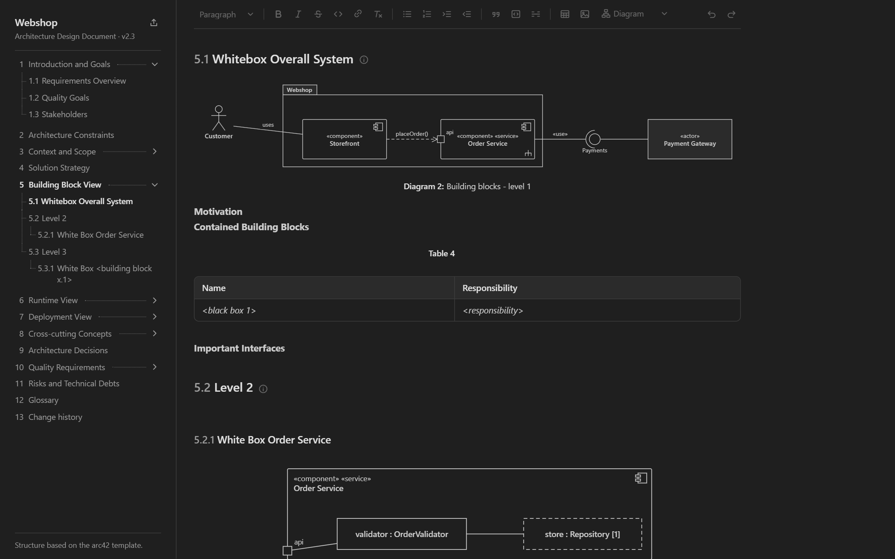
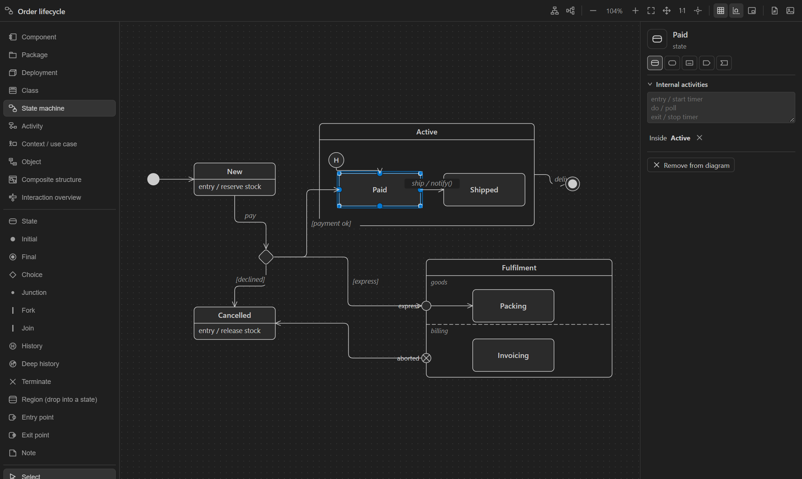

<p align="center"></p>

<h1 align="center">Archery</h1>

<p align="center">Architecture docs as code for VS Code: an arc42 document you write like a page, UML diagrams drawn on one shared model, and Claude Code or GitHub Copilot working on it with you, live.</p>



Documents follow the structure of the [arc42](https://arc42.org) template. Archery is an independent project, not affiliated with the arc42 authors.

## Install

- **From VS Code:** open the Extensions view (`Ctrl+Shift+X`), search for **Archery**, and click **Install**. Or run `ext install lesyhau.archery` from the Quick Open (`Ctrl+P`).
- **From a VSIX:** download `archery-<version>.vsix` from [Releases](https://github.com/lesyhau/archery/releases), then run **Extensions: Install from VSIX…** in VS Code.

Open a folder and run **Archery: Initialize Architecture Documentation**. It creates `docs/architecture/` with the twelve arc42 chapters, a model and the data lists. Click the **Archery** icon in the activity bar to open the document.

The sidebar has three views:
- **Contents:** the chapters and their headings. Click one to go there; the chapter you are reading is selected while you scroll.
- **Diagrams:** every diagram, also those no chapter shows yet. Right-click one for **Open Source**.
- **Diagram Tools:** the palette and properties of the diagram you are editing, so the diagram tab can use its full width.

## Features

- **The whole document on one page,** laid out like a published architecture document. Click any text to edit it in place; every chapter is a Markdown file. The toolbar has paragraph styles, lists, quotes, code, links, tables, images and diagrams, with undo and redo.
- **arc42 guidance where you write.** Every heading has an info icon with what belongs in that chapter. It stays open until you click elsewhere.
- **A contents panel** with numbered chapters and subsections (`1.2`, `5.2.1`). Drag a subsection to move it, also into another chapter, and the numbers follow. Right-click to add, promote or demote headings.
- **Diagrams anywhere in the text,** with a numbered caption below. Hover one for zoom, edit, maximize and remove. **Edit** (or a double-click) opens it in its own tab, named after the diagram.
- **Tables:**
  - Markdown tables in the text and editable data tables for the structured chapters (quality goals, stakeholders, constraints, quality scenarios, risks, glossary), stored as YAML.
  - Hover a row or column for its grip (drag to move) and delete button. Hover a line between rows or columns for a **+** that inserts one there.
  - In data tables, drag a column line to resize, or double-click it to fit the column to its content. Select cells to merge them.
- **Numbered captions:** Table N, Diagram N and Figure N, counted through the whole document. Click a caption to edit it.
- **Versions.** Every saved change raises the minor version (v1.1, v1.2, …). **Release** creates the next major version with a change log entry and keeps a snapshot. **Restore a Release** rolls back to any release. The change history is the document's last chapter.
- **Export** to PDF or to one self-contained HTML file:
  - The PDF has bookmarks and page numbers in its contents. It is printed by an installed Edge, Chrome, Chromium or Brave.
  - Choose fonts, page size and margins, header and footer, page numbers and the contents depth. The choices are saved with the documentation, so the whole team exports the same way.

### UML on a shared model



Elements and relationships are defined once in `model.yaml`; diagrams are views onto them, so a rename shows up everywhere. All 13 UML 2 diagram types:

| Diagram | Notation |
| --- | --- |
| Component, deployment, package | Components, ports, provided and required interfaces (lollipop and socket), nodes, execution environments, artifacts, «use», «deploy», «manifest» |
| Class, object | Attributes and operations in UML text, generics, multiplicities, roles, qualifiers, navigability, association classes, data types, enumerations; instances with slots and links |
| Composite structure | Structured classes with parts, ports and connectors, collaborations and collaboration uses |
| Use case | Actors, use cases with scenarios and extension points, «include» and «extend», the subject |
| State machine | Composite states with orthogonal regions, entry and exit points, choice, junction, fork and join, history, terminate |
| Activity | Actions with pins, swimlanes, decisions, signals, accept (time) events, object flows, interruptible regions |
| Interaction overview | Activity flow between interaction uses and inline interactions |
| Sequence, communication | All message kinds, gates, the 12 combined fragment operators, references, notes, state invariants; or the same interaction as a communication diagram |
| Timing | State timelines and value lifelines over a time axis, timed messages, duration constraints and time observations |

In the editors:
- **Palette and properties.** Add elements by click or drag, pick a relationship tool, or bring in existing model elements. The palette shows names when it is wide enough; drag its edge to resize it. The properties show the selected element's details, its relations grouped by meaning, and the other diagrams it appears in.
- **Arrange.** Select two or more shapes to align or distribute them, from the toolbar or the right-click menu. Automatic layout, bend points, snap to grid.
- **Labels and lines.** Drag any line label away from its line; a dotted line keeps them connected. In the Modern style, drag a straight part of a line to move it.
- **Drill-down.** Set **Detailed in** on an element to the diagram that shows its inside. Every other diagram marks its box with the UML rake; click it to open that diagram, or, in the document, to jump to the chapter that shows it.
- **Two styles.** **Classic** and **Modern** (rounded corners, light fills, right-angle lines, muted labels), used by the editors, the document and every export.

## Claude Code and GitHub Copilot

Both get the same tools, so an agent can do what you do in the document and the editors:

- **Chapters:** read, edit and rewrite text; place diagrams, data tables and the decision list, with captions.
- **Model and diagrams:** elements and relationships; create and fill diagrams; move, resize, align, route and lay out; drill-down links; sequence and timing diagrams.
- **Tables and decisions:** rows, columns and merged cells; architecture decision records.
- **Versions and export:** list, release and restore versions; export the document or a diagram.

The tools keep ids stable, update references across files, keep YAML comments and validate before they write.

**You see what the agent does.**
- **A chapter:** before it changes, the document scrolls to the part being edited, then the change lands and is highlighted.
- **A diagram:** the document scrolls to the chapter that shows it, the diagram opens in its tab, then the new or changed shapes are selected and outlined.
- **A table:** it comes into view before its rows change.
- **Undo:** agent edits can be undone like your own.

| | Claude Code | GitHub Copilot |
| --- | --- | --- |
| How | MCP server | Language model tools (`archery_*`) and the `@archery` chat participant |
| Setup | Run **Archery: Set up Claude Code (MCP server)** once | None: available in agent mode |
| Edits | Shown live in the VS Code window that has the documentation open; written to the files when there is none | Shown live, one undoable edit per tool call |

The setup command registers the MCP server for all your projects or for this one. Node.js must be on PATH.

## Your documentation

```
docs/architecture/
  archery.yaml        project, chapter order, export settings
  model.yaml          the shared model: elements and relationships
  sections/           one Markdown file per chapter
  data/               the structured chapters as YAML
  decisions/          architecture decision records
  diagrams/           *.uml.json, *.seq.json, *.timing.json
  images/             pasted and dropped images
  .versions/          version history and release snapshots
```

Everything is plain text in your repository, so it diffs, reviews and merges like code. Chapters place generated content with comments that Markdown previews hide, for example `<!-- archery:diagram diagrams/building-blocks-l1.uml.json caption="System overview" -->`.

## Settings

| Setting | Default | |
| --- | --- | --- |
| `archery.diagramStyle` | `classic` | `classic` or `modern` diagrams in the editors, the document and exports |
| `archery.followAgent` | `true` | Show what AI agents change while they change it |
| `archery.canvas.snapToGrid` | `true` | Snap shapes, sizes and bend points to the grid |
| `archery.canvas.showGrid` | `true` | Show the grid in the diagram editor |
| `archery.canvas.gridSize` | `10` | Grid size in pixels |
| `archery.export.browserPath` | `""` | Browser that prints PDFs (empty: find Edge, Chrome, Chromium or Brave) |

## Contributing

Issues and pull requests are welcome at [github.com/lesyhau/archery](https://github.com/lesyhau/archery). See [CONTRIBUTING.md](CONTRIBUTING.md) for building and releasing.

## Credits

Chapter structure and guidance texts are based on the arc42 template, © Dr. Peter Hruschka, Dr. Gernot Starke and contributors ([arc42.org](https://arc42.org)), licensed under [CC BY-SA 4.0](https://creativecommons.org/licenses/by-sa/4.0/). The guidance Archery ships and writes into new documentation is a shortened adaptation and stays under CC BY-SA 4.0.

## License

The code is [MIT](LICENSE). The arc42 template content it includes is CC BY-SA 4.0 (see [LICENSE](LICENSE)). What you write in your documentation is yours.
